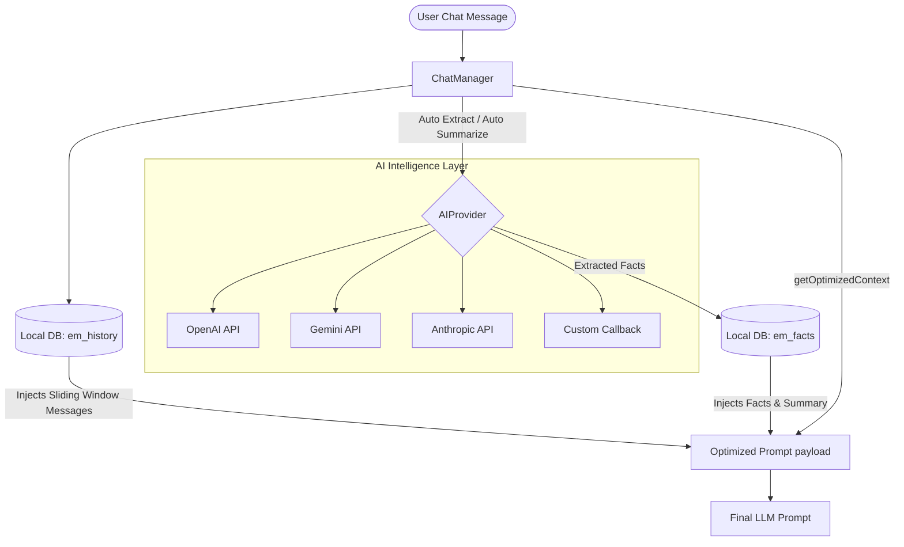

# ElePHPantMemory 🐘💬

[](#)
[](https://www.php.net)
[](LICENSE)
[](#)
[](#)
[](#)

An ultra-lightweight, zero-dependency local memory and context manager for AI chatbots. Written in pure, modern PHP 8.4+ using property hooks and asymmetric visibility.

*Gestor de memória e contexto local para chatbots de IA. Ultra leve, rápido e sem dependências externas. Escrito em PHP 8.4+ puro e moderno.*

---

## 🧐 "Does anyone actually use this, or is it completely useless?" / "Quem é que usa esta merda?"

### English
If you are building an AI chatbot using standard APIs (like OpenAI, Claude, or Gemini) and think *"I'll just pass the entire chat history in every request,"* you will quickly realize:
1. **Your API bill explodes** as the conversation grows.
2. **The chatbot loses its mind** when the conversation exceeds token limits.
3. **Setting up a Vector Database** (Pinecone, pgvector) just to store simple facts (like the user's name, city, or order preferences) is massive overkill.

**ElePHPantMemory** solves this inside your **existing database** (SQLite, MySQL, Postgres, SQL Server) without any extra services:
* 🔋 **Zero Dependencies:** Fits into any PHP project, no vendor bloat.
* 🧠 **Dual-Tier Memory:** Keeps recent chat history in a sliding window (Short-Term) and extracts/stores facts (Long-Term) to inject as system prompts.
* ✂️ **Smart Summarization:** When the token limit is hit, it automatically summarizes older history using the LLM and keeps the summary as a persistent fact, purging raw old messages to save database space and API tokens.

---

### Português (Portugal)
Se estás a desenvolver um chatbot de IA com APIs (OpenAI, Claude, Gemini) e pensas *"basta-me mandar o histórico todo em cada pedido"*, vais perceber muito rápido que:
1. **A tua fatura da API explode** à medida que a conversa avança.
2. **O chatbot perde o fio à meada** quando as mensagens excedem o limite de tokens.
3. **Instalar uma base de dados vetorial** (Pinecone, pgvector) só para guardar factos básicos (como o nome do utilizador, a cidade ou o ID da encomenda) é complicar o que devia ser simples.

O **ElePHPantMemory** resolve isto diretamente na tua **base de dados atual** (SQLite, MySQL, Postgres, SQL Server):
* 🔋 **Zero Dependências:** Funciona em qualquer projeto PHP, sem encher o `vendor`.
* 🧠 **Memória de Duas Camadas:** Mantém as mensagens recentes numa janela deslizante (Curto Prazo) e extrai/guarda factos importantes (Longo Prazo) para injetar no prompt de sistema.
* ✂️ **Sumarização Inteligente:** Quando atinge o limite de tokens, usa a própria IA para criar um resumo das mensagens antigas, guarda-o e apaga o histórico bruto para poupar espaço e tokens.

---

## 🗺️ How it Works / Como Funciona



---

## 📊 Features & Comparison / Caraterísticas e Comparação

| Feature / Funcionalidade | Standard AI Chat Flow | With ElePHPantMemory 🐘 |
| :--- | :---: | :---: |
| **API Token Costs** / *Custos de Tokens* | 📈 Increases exponentially | 📉 Flat and optimized |
| **Memory Retention** / *Retenção de Memória* | ❌ Forgets when context limits hit | 🧠 Never forgets core facts |
| **Dependencies** / *Dependências* | 📦 Heavy framework overhead | ❌ Zero (Vanilla PHP 8.4+) |
| **Database Setup** / *Configuração de BD* | ⚙️ Requires external Vector DB |  Reuses your active connection |
| **GDPR Compliance** / *Pronto para RGPD* | 🛠️ Manual code required | ⚡ Automated local TTL purging |

---

## 🛠️ Quick Start / Guia Rápido

### Installation / Instalação

#### Option A: Composer (Recommended / Recomendado)
```bash
composer require elephpantmemory/memory
```

#### Option B: Manual Include / Importação Manual
Download the package files and include the main manager file:
*Descarrega os ficheiros do pacote e importa o ficheiro do gestor principal:*
```php
require_once 'ElePHPantMemory/autoload.php';
```

---

## 🚀 Usage Examples / Exemplos de Uso

### 1. Basic Local Storage (Manual Facts) / Armazenamento Local Simples (Factos Manuais)
Manually save messages and facts (useful if you handle the AI calls manually for fact extraction).
*Regista mensagens e factos manualmente (útil se já tratas da chamada de IA de outra forma).*

```php
use ElePHPantMemory\ChatManager;

// 1. Re-use your active database connection (PDO or mysqli)
// Compatible with MySQL, SQLite, PostgreSQL and SQL Server!
$memory = new ChatManager(
    existingConnection: $myActivePDO, 
    maxTokens: 2000, 
    purgeAfterDays: 15 // Auto-GDPR cleanup
);

$session = 'whatsapp_user_912345678';

// 2. Log messages normally (respects maxTokens sliding window)
$memory->addMessage($session, 'user', 'Hello, my name is Ze Povinho and my VAT/NIF is 123456789.');

// 3. Save extracted facts manually
$memory->saveFact($session, 'user_name', 'Ze Povinho');
$memory->saveFact($session, 'vat_number', '123456789');

// 4. Build the optimized payload ready for your AI API call
// Contains: System Prompt with Facts + recent chat history within maxTokens limits
$aiPayload = $memory->getOptimizedContext($session);
```

### 2. Intelligent Auto-Memory (Zero-Dependency AI Integration)
Let ElePHPantMemory automatically extract facts from chats and summarize old conversations using OpenAI or Gemini natively (via cURL).
*Deixa o ElePHPantMemory extrair factos e sumarizar conversas antigas automaticamente usando OpenAI ou Gemini nativo (via cURL).*

```php
use ElePHPantMemory\ChatManager;
use ElePHPantMemory\GeminiProvider; // Or OpenAIProvider / AnthropicProvider / CustomProvider

// 1. Instantiate the AI Provider (Zero external packages needed!)
// Timeouts are fully configurable in seconds (defaults to 30)
$ai = new GeminiProvider(apiKey: 'YOUR_GEMINI_API_KEY', model: 'gemini-1.5-flash', timeout: 45);
// Or: $ai = new OpenAIProvider(apiKey: 'YOUR_OPENAI_API_KEY', model: 'gpt-4o-mini', timeout: 45);
// Or: $ai = new AnthropicProvider(apiKey: 'YOUR_CLAUDE_API_KEY', model: 'claude-3-5-sonnet-latest', timeout: 45);

$memory = new ChatManager(
    existingConnection: $myActivePDO,
    maxTokens: 1500,
    purgeAfterDays: 30,
    aiProvider: $ai
);

// Enable automatic facts extraction on addMessage()
$memory->autoExtractFacts = true;

$session = 'user_session_123';

// 2. Add message. Fact extraction will trigger automatically in the background!
$memory->addMessage($session, 'user', 'Hi, my name is Rui, I live in Lisbon and prefer PHP.');

// 3. Get specific extracted facts
$userName = $memory->getFact($session, 'user_name'); // 'Rui'
$location = $memory->getFact($session, 'location');  // 'Lisbon'

// 4. If maxTokens is hit, older messages are summarized into '_conversation_summary'
// and deleted from history automatically!
$aiPayload = $memory->getOptimizedContext($session);
```

### 3. Custom Providers / Integração de Provedores Customizados
If you use a framework wrapper (like Laravel's LLM clients, or a custom wrapper), you can bind it directly using `CustomProvider`.
*Se usas outro wrapper de IA (ex: pacotes do Laravel ou SDKs oficiais), podes integrá-lo usando o `CustomProvider`.*

```php
use ElePHPantMemory\ChatManager;
use ElePHPantMemory\CustomProvider;

$ai = new CustomProvider(function (array $messages, array $options = []): string {
    // Send the messages array to your custom AI client and return raw string response
    return $myLaravelAIClient->chat($messages);
});

$memory = new ChatManager($db, 2000, 30, $ai);
```

### 4. Memory Lifecycle Operations / Gestão do Ciclo de Vida da Memória
```php
// Delete a specific fact / Apaga um facto específico
$memory->deleteFact($session, 'vat_number');

// Clear all facts / Limpa todos os factos
$memory->clearFacts($session);

// Clear message history / Limpa o histórico de mensagens
$memory->clearHistory($session);

// Delete entire session data / Apaga todos os dados da sessão
$memory->deleteSession($session);
```

### 5. Custom Table Prefixes / Prefixo de Tabelas Customizado
If you want to prevent database table name conflicts with your existing tables, you can configure a custom prefix (default is `em_`) in the constructor.
*Se quiseres evitar conflitos de nomes de tabelas na tua base de dados, podes definir um prefixo personalizado (o padrão é `em_`) no construtor.*

```php
// The library will automatically initialize `myprefix_history` and `myprefix_facts`
$memory = new ChatManager(
    existingConnection: $db,
    tablePrefix: 'myprefix_'
);
```

### 6. Temporary Facts (TTL Expiration) / Factos Temporários (Expiração por TTL)
You can set an optional TTL in seconds for specific facts. The library automatically cleans up expired facts during runtime context generation.
*Podes definir um tempo de vida útil (TTL) em segundos para factos específicos. A biblioteca limpa automaticamente os factos expirados em tempo de execução.*

```php
// Save a fact that expires in 1 hour (3600 seconds)
$memory->saveFact($session, 'temp_location', 'Hotel Room 402', 3600);

// Expired facts are automatically filtered out when fetching context:
$aiPayload = $memory->getOptimizedContext($session);
```

### 7. Custom Extraction Guidelines / Diretrizes de Extração Personalizadas
Guide the AI on what details to extract (or ignore) during automatic fact extraction.
*Orienta a IA sobre que detalhes extrair (ou ignorar) durante a extração automática de factos.*

```php
$memory->autoExtractFacts = true;

// Instruct the LLM to only extract business preferences
$memory->extractionGuidelines = "Only extract corporate info, billing preferences, and VAT numbers. Ignore personal data.";

$memory->addMessage($session, 'user', 'My VAT is 123456789 and I hate pineapple pizza.');
// Only VAT will be extracted!
```

### 8. Custom Context Formatters / Formatador de Contexto Customizado
Customize how facts and summaries are formatted in the system prompt injected into your AI calls.
*Personaliza a forma como os factos e o sumário são formatados no prompt do sistema injetado nas chamadas de IA.*

```php
// Format facts as JSON inside the system prompt instead of the default [key: value] brackets
$memory->contextFormatter = function(array $facts): string {
    $clean = [];
    foreach ($facts as $f) {
        $clean[$f['fact_key']] = $f['fact_value'];
    }
    return "User Profile JSON: " . json_encode($clean);
};

$aiPayload = $memory->getOptimizedContext($session);
// The first system message in $aiPayload will contain:
// "User Profile JSON: {"user_name":"Rui","preferred_language":"PHP"}"
```

---

## 🏗️ Requirements & DB Schemas / Requisitos e Esquemas de BD

* **PHP 8.4+** (Utilizes cutting-edge property hooks and asymmetric visibility).
* An active database connection instance using **`PDO`** (MySQL, SQLite, SQL Server, PostgreSQL) or **`mysqli`**.

The library automatically checks and initializes these two tables:
1. `em_history`: Stores message history.
2. `em_facts`: Stores extracted facts and conversation summaries.

---

## 🛡️ Error Handling / Tratamento de Erros

ElePHPantMemory throws custom exceptions under the `ElePHPantMemory` namespace, all extending `ElePHPantException`:
* **`ValidationException`**: When configuration parameters are invalid (e.g. `maxTokens` limit is below 500).
* **`StorageException`**: When database connections fail, queries fail, or prepared statement operations fail.
* **`AIException`**: When cURL connection fails, API responds with error, or JSON parsing/mapping fails.

```php
try {
    $memory = new ChatManager($db, 2000, 30, $ai);
    $memory->addMessage($session, 'user', 'Hello!');
} catch (\ElePHPantMemory\ValidationException $e) {
    echo "Validation failed: " . $e->getMessage();
} catch (\ElePHPantMemory\StorageException $e) {
    echo "Database error: " . $e->getMessage();
} catch (\ElePHPantMemory\AIException $e) {
    echo "AI Provider error: " . $e->getMessage();
} catch (\ElePHPantMemory\ElePHPantException $e) {
    echo "General library error: " . $e->getMessage();
}
```

---

## 🧪 Testing / Testes

You can run the built-in, zero-dependency test suite using the following command:
*Podes correr a suite de testes integrada e sem dependências usando o seguinte comando:*

```bash
php run_tests.php
```

---

## 🤝 Contributing / Contribuir

Contributions are welcome! Please check [CONTRIBUTING.md](CONTRIBUTING.md) for architecture guidelines. Keep it dependency-free, and ensure PHP code files remain ASCII-clean (no special accents in class/method names or comments).

*Contribuições são bem-vindas! Verifica o ficheiro [CONTRIBUTING.md](CONTRIBUTING.md) para diretrizes de arquitetura. Mantém o código PHP livre de dependências externas e sem caracteres especiais ou acentos no código fonte.*

---

## ⚖️ License / Licença

This project is licensed under the **GNU General Public License v3.0 (GPL-3.0)** - see the [LICENSE](LICENSE) file for details.

*Este projeto está licenciado sob a **GNU General Public License v3.0 (GPL-3.0)** - consulta o ficheiro [LICENSE](LICENSE) para mais detalhes.*